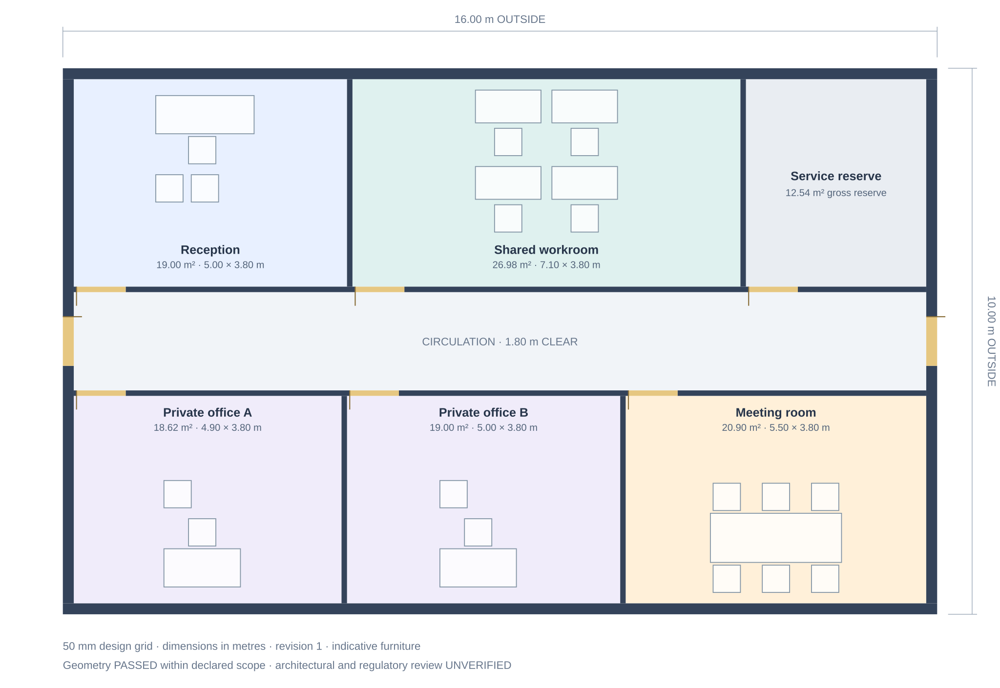

# Floor Plan Studio

Constraint-based office floor plans with independently checked geometry.

A local feasibility prototype for one question: can a user review a structured office brief, generate a usable dimensioned layout, change a requirement, and receive either newly checked geometry or an honest conflict explanation?

[Narrated walkthrough](docs/media/floor-plan-walkthrough.mp4) · [Demo and evidence](docs/DEMO.md)

## Windows quick start: target under 5 minutes

Download the source of this public repository in your browser. A Git installation is optional.

**Time estimate:** about 2–5 minutes with Python 3.12 already installed and a working internet connection. Installing Python or downloading dependencies on a slow connection can take longer.

### 1. Download and extract the project

1. At the top of this repository's **Code** page, click the green **Code** button, then **Download ZIP**. You can also [download the main branch ZIP directly](https://github.com/Ameen-GAMAL/floor-plan-studio/archive/refs/heads/main.zip).
2. In your Windows **Downloads** folder, right-click the ZIP and choose **Extract All**, then **Extract**.
3. Open the extracted folders until you see **run.py**, **requirements.txt** and the **app** folder together. This is the project folder. Run the demo from this extracted folder, not from inside the ZIP preview.

### 2. Open PowerShell in the project folder

In File Explorer, click the address bar of the folder containing **run.py**, type **powershell**, and press **Enter**.

### 3. Install dependencies and start the server

Run these commands **one line at a time**. The first command should print **Python 3.12.x**. If it fails, use the Python fix below before continuing.

~~~powershell
py -3.12 --version
py -3.12 -m venv .venv
.\.venv\Scripts\python.exe -m pip install -r requirements.txt
.\.venv\Scripts\python.exe run.py
~~~

Wait for dependency installation to finish before starting the server. When PowerShell shows **Uvicorn running on http://127.0.0.1:8000**, leave that window open.

### 4. Open the demo

Open **[http://127.0.0.1:8000](http://127.0.0.1:8000)** in Edge or Chrome.

Select **Small office**, continue through the three brief steps, then click **Generate floor plan**. Select a room to inspect its dimensions, and open **Room schedule** and **Validation report**.

To try a live change, set the meeting-room minimum to **24 m²** and regenerate.

### Next time

Open PowerShell in the same extracted project folder and run only:

~~~powershell
.\.venv\Scripts\python.exe run.py
~~~

Open the same browser address. Stop the server with **Ctrl+C** when finished. Dependency installation needs internet access; the installed demo runs locally without a paid API, API key or runtime account.

### Quick Windows fixes

- **Python 3.12 is missing or py is not recognized:** install the **Windows installer (64-bit)** from the [official Python 3.12 download page](https://www.python.org/downloads/release/python-31210/), with the Python launcher included. Close and reopen PowerShell in the project folder, then repeat step 3.
- **run.py or requirements.txt cannot be found:** open the inner extracted folder where both files are visible, then open PowerShell there.
- **Port 8000 is already in use:** run the command below and open **[http://127.0.0.1:8001](http://127.0.0.1:8001)** instead.

~~~powershell
.\.venv\Scripts\python.exe run.py --port 8001
~~~

Actual baseline output from the implemented solver and validator. Furniture is indicative; architectural and regulatory review remains unverified.

## What works

- Three-step adaptive questionnaire with explicit fixed geometry and editable area bounds.
- Real OR-Tools CP-SAT generation, with no paid API, LLM, or trained model required.
- Separate Shapely/NetworkX validation of exported polygons, walls, apertures and connectivity.
- Room inspection, measured schedules, a gross-area ledger and per-requirement evidence.
- Requirement changes with immediate stale-result rejection and real regeneration.
- Distinct conflict, unresolved-search, unsupported-input and invalid-input outcomes.
- Dimensioned SVG and JSON exports tied to the exact brief revision and digest.

## Present the prototype

1. Complete the **Small office** questionnaire and review the structured brief.
2. Generate a floor plan. Select a room, then inspect **Room schedule** and **Validation report**.
3. Set the meeting-room minimum to **24 m²** and regenerate. The executed Windows reference produces **24.13 m²**.
4. Select **Area conflict** and generate. The report explains **172 m²** of minimum room area against **149.76 m²** inside the shell.
5. Restore **Small office**, regenerate and download the current SVG or JSON.

Changing a brief immediately removes the old acceptance state and disables old exports. Presets contain inputs only: every live result goes through the solver and validator.

See the [presenter guide](docs/DEMO.md) for the complete demonstration. Refresh starts from the baseline; download JSON to retain a study. There is no database.

## Design family and limits

One rectangular small-office floor is represented in integer millimetres on a default 50 mm grid. Rectangular rooms occupy two banks beside a straight full-width corridor, with a fixed service reserve at a bank end. The program includes reception, a shared workroom, a meeting room and one to four private offices.

Supported relationships distinguish a shared wall from an actual direct doorway. Furniture comes from a finite catalogue. Changing the footprint does not move the fixed core, corridor or openings: compatible coordinates must be supplied explicitly.

Interior obstructions, arbitrary polygons, free-form corridors, other building types and 3D are outside this version. Such inputs return **unsupported**, rather than a claim of architectural infeasibility.

**A geometry pass is not architectural or regulatory approval.** Survey accuracy, furniture operation, door swings, accessible and finite-width paths, fire/egress requirements, structural/MEP coordination and service-core contents remain unverified. Thresholds are project assumptions, not verified building-code requirements. A qualified architect must review any real use.

## How the evidence works

The generator selects room bank, position, width, furniture orientation and doorway offset with CP-SAT. Every bank is tiled with rooms, the fixed core and explicit walls. Target-area deviation is the primary objective, followed by declared zoning/proximity preferences and stable ordering.

The validator imports neither the generator nor its constraint-building code. It recomputes exported geometry, physical door contacts and graph connectivity. A candidate is released only after every implemented mandatory check passes. The report records measured values, expected values, units, tolerances, provenance and pass/fail/unverified statuses.

The objective and proof concern the encoded layout family. They do not establish the best architectural arrangement or exclude solutions in other layout families.

| Outcome | Meaning |
| --- | --- |
| feasible + passed | A candidate passed all implemented mandatory geometry checks. Separate unverified reviews remain. |
| infeasible / necessary_condition | A direct contradiction was established, such as minimum room area exceeding the inside shell. |
| infeasible / solver_proof | No solution exists in the encoded grid/layout family. The sufficient conflict set need not be minimal. |
| unknown | Search ended without a candidate or proof. This is not a conflict finding. |
| unsupported | The request falls outside the implemented geometry or relationship family. |
| invalid_input | Missing/invalid fields or contradictory minimum/maximum bounds need correction. |
| feasible + failed | Independent checks rejected the solver candidate; no layout or SVG is released as valid. |
| error | A runtime or implementation failure occurred. Requirements were retained. |

Default search settings are a 25-second budget, one worker and fixed seed 20261015. Feasible incumbents may pass validation without proven objective optimality. The initial end-to-end target is 30 seconds on the presentation computer; recorded timings are machine-specific.

## Verify and package

~~~powershell
.\.venv\Scripts\python.exe -m pip check
.\.venv\Scripts\python.exe -m pytest -q
.\.venv\Scripts\python.exe scripts\offline_smoke.py
.\.venv\Scripts\python.exe scripts\package_project.py
~~~

The acceptance suite contains **29 tests**, including intentionally damaged exports, stale revisions, known conflicts and unresolved searches. [CI](.github/workflows/ci.yml) runs checks on Windows and Ubuntu with Python 3.12. Its uploaded artifacts include the source archive and executed test evidence.

The package command creates **outputs/floor-plan-studio.zip** and enables its local browser download. Generated ZIPs, local environments, logs and historical illustrative studies are excluded from Git.

To refresh the four saved API evidence runs while the server is running:

~~~powershell
.\.venv\Scripts\python.exe scripts\evaluate.py
~~~

This replaces the recorded output files; review the resulting diff before committing.

## Repository guide

| Location | Purpose |
| --- | --- |
| [app/](app/) | Typed brief, generator, independent validator, SVG export, API and browser UI |
| [examples/](examples/) | Four reproducible input briefs, including a deliberately impossible case |
| [tests/](tests/) | Acceptance, mutation, outcome and export checks |
| [outputs/](outputs/) | Executed geometry/evaluation evidence; never substituted for a live solve |
| [docs/ARCHITECTURE.md](docs/ARCHITECTURE.md) | Technical design, contract and validation boundary |
| [docs/DEMO.md](docs/DEMO.md) | Presenter walkthrough and expected outcomes |
| [PLAN.md](PLAN.md) | Agreed scope, requirements and completed implementation milestones |
| [VALIDATION.md](VALIDATION.md) | Executed checks, environment, measurements and unverified reviews |
| [CONTRIBUTING.md](CONTRIBUTING.md) | Development and review conventions |

## Local API

| Method and path | Purpose |
| --- | --- |
| GET /api/health | Runtime health |
| GET /api/presets/{name} | baseline, changed, impossible or alternative brief |
| GET /api/requirements | Requirement register and provenance |
| POST /api/generate | Generate and independently validate a typed brief |
| POST /api/validate | Validate a supplied brief/layout pair |
| POST /api/export/svg | Revalidate the pair and export, or return HTTP 422 |

The server binds to **127.0.0.1**. One generation runs at a time; concurrent requests receive HTTP 429. Field errors receive HTTP 422. Public hosting and multi-user operation are outside this prototype.

Useful browser pages are **/guide**, **/plan** and **/validation**. There is no deployment service, CDN, telemetry integration or remote-font dependency.

## Troubleshooting

- **Cannot reach the app:** start the server and use its printed local address.
- **Input error:** inspect the field message. Increasing a minimum never silently raises its maximum.
- **Unsupported fixed geometry:** review coordinates; fixed elements are not moved automatically.
- **Search budget reached:** retain the unresolved outcome; review requirements or explicitly retry.
- **Stale/damaged export:** validate it against its exact brief and revision/hash.

## Other platforms

After downloading or cloning the project, open a terminal in the folder containing **run.py**. On macOS/Linux with Python 3.12:

~~~sh
python3.12 -m venv .venv
.venv/bin/python -m pip install -r requirements.txt
.venv/bin/python run.py
~~~

Open http://127.0.0.1:8000. On later starts, run only the final command.

Primary tool documentation: [OR-Tools CP-SAT](https://developers.google.com/optimization/cp/cp_solver), [FastAPI](https://fastapi.tiangolo.com/), [Shapely](https://shapely.readthedocs.io/en/stable/manual.html), [NetworkX](https://networkx.org/documentation/stable/reference/algorithms/shortest_paths.html).
